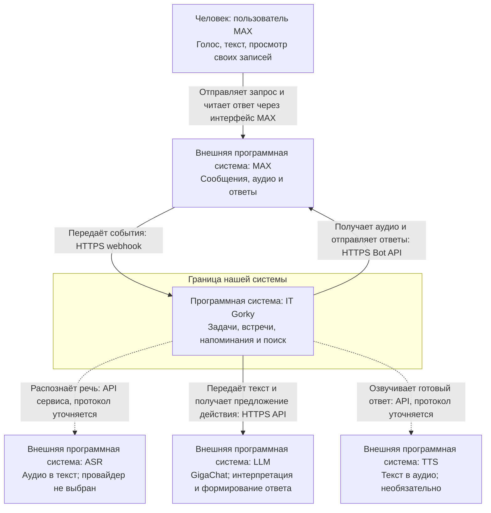
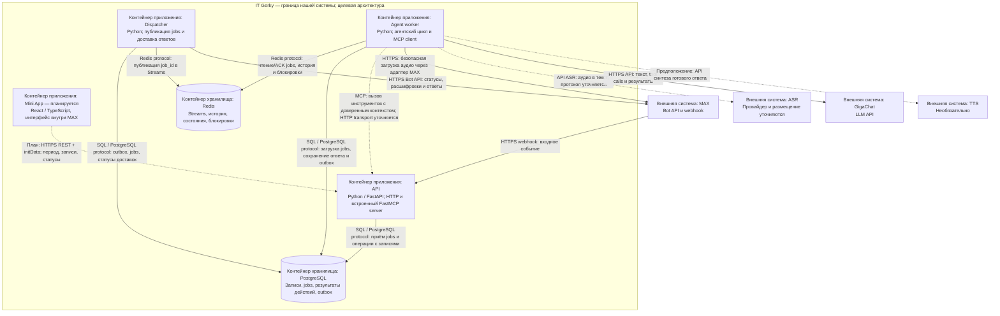
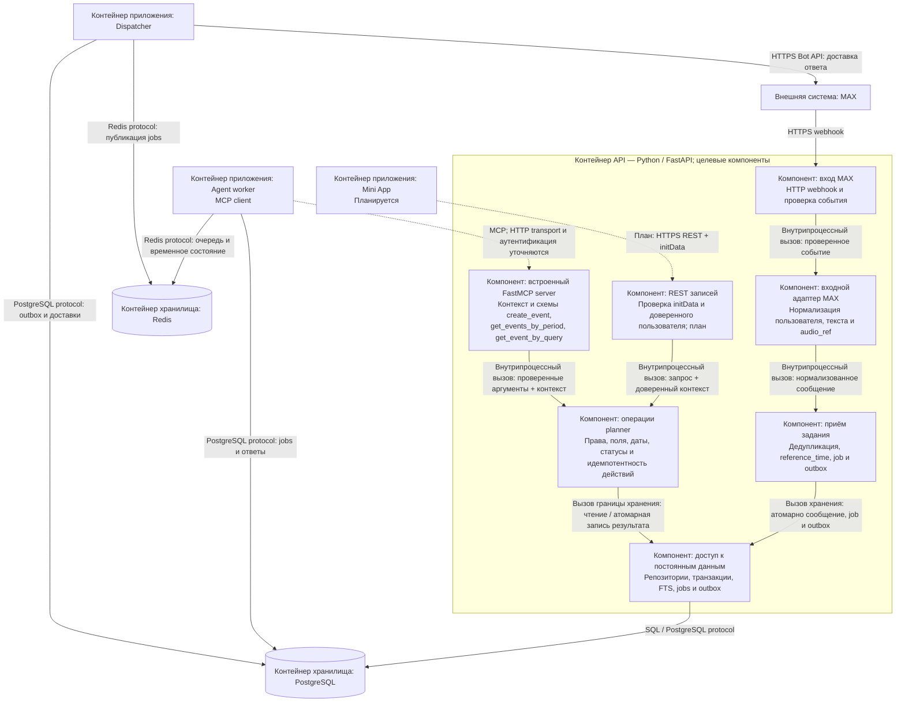

# C4: голосовой ассистент IT Gorky для MAX

Состояние репозитория проверено 21 октября 2026 года. Основания:
[AGENTS.md](../AGENTS.md), [README](../README.md),
[ARCHITECTURE.md](ARCHITECTURE.md) и содержимое `app/`, `tests/`, `evals/`.
Предыдущий архитектурный план и расшифровка обсуждения отражены в ARCHITECTURE.md;
они не входят в репозиторий. Актуальное размещение — один Python-проект с пакетом
`app/`, заменяющий прежний путь `backend/src/assistant/`.

## 1. Реализация, целевые решения и предположения

**Фактически реализовано:** каркас пакетов, README и архитектурная документация.
Все 11 файлов `app/**/__init__.py` пусты; в `tests/` и `evals/` только `.gitkeep`.
Нет прикладного кода, manifest/lock зависимостей, миграций, точек запуска,
конфигурации развёртывания и автоматических проверок. Ни один пользовательский
сценарий пока не реализован. Каталог обозначает место будущего кода, а не компонент,
который уже работает.

**Согласованная целевая архитектура:** три процесса одной кодовой базы — API,
agent worker и dispatcher. MCP server встроен в API, MCP client используется
агентом. PostgreSQL хранит записи, jobs, результаты действий и outbox;
Redis — очередь Streams и временные историю, состояния и блокировки.
REST и MCP вызывают общий planner, независимый от MAX и AI-провайдеров.
Четыре основных действия: создание задачи/напоминания, создание встречи,
получение за период и поиск. Текст и голос используют общий сценарий.
Mini App планируется; TTS необязателен, доставка напоминаний по расписанию —
следующий блок после основного пути.

**Предположения для схем:** MCP между процессами будет передаваться по HTTP,
а ASR будет внешним сервисом. Конкретный MCP transport и выбор размещения ASR
не утверждены. Необязательный TTS условно показан в agent worker; его место
выполнения ещё нужно выбрать. Эти предположения не означают готовых интеграций.
Другие открытые вопросы собраны в конце документа.

Все три диаграммы ниже показывают **целевую архитектуру**. Прямоугольники имеют
явный тип: человек, программная система, контейнер приложения/хранилища или
компонент. Контейнер C4 — исполняемое приложение либо хранилище, он не обязательно
совпадает с Docker-контейнером. Стрелки обозначают инициатора обращения и назначение
связи; ответ на вызов подразумевается. Пунктир выделяет планируемую необязательную
связь или ещё не выбранный способ интеграции, а не факт реализации остальных связей.

## 2. C1 — System Context

Рассматривает систему целиком: кому она помогает и с какими внешними системами
обменивается данными. Внутренние процессы, компоненты и базы скрыты.

Пользователь общается через MAX; ассистент управляет его записями и возвращает
понятный результат. MAX отвечает за канал общения, ASR — за расшифровку,
LLM — за предложение действия и текст ответа, TTS — за необязательную озвучку.
Модель не получает прямого доступа к данным. Конкретные форматы внешних API
будут проверены при интеграции; здесь указаны только принятые или предполагаемые
протоколы. Планируемый Mini App даст пользователю дополнительный интерфейс
той же системы внутри MAX; на C1 он не выделен в отдельную систему.

## 3. C2 — Containers

Рассматривает процессы и хранилища внутри IT Gorky и обмен между ними.
Пакеты Python и MCP-инструменты на этом уровне не становятся отдельными сервисами.

API быстро принимает событие и надёжно фиксирует задание. Dispatcher переносит
сохранённые задания в очередь и доставляет подготовленные сообщения. Worker
выполняет долгую обработку и вызывает инструменты внутри API. SQL-связь worker
нужна для jobs и результатов обработки; создание пользовательской записи идёт
через MCP и planner в API. PostgreSQL — источник постоянных данных, Redis —
оперативное состояние и очередь. Outbox — данные в PostgreSQL, отдельного
брокера или четвёртого Python-процесса для него нет.

Планируемый Mini App показан внутри границы нашей системы как приложение,
исполняемое в клиенте MAX. Это не дополнительный Python-процесс. Он будет читать
те же записи через REST, с серверной проверкой исходной initData. Способ выдачи
frontend и пользовательской сессии ещё не выбран.

## 4. C3 — Components внутри API

Увеличивает только API из C2. Компоненты — логические части этого приложения;
несколько частей могут использовать один пакет. Worker, dispatcher, Mini App,
MAX и хранилища находятся за границей **API**, хотя часть из них принадлежит
нашей системе. Их внутреннее устройство здесь не раскрывается.

MAX-вход проверяет событие, адаптер приводит его к внутреннему формату,
приём фиксирует задание. REST и MCP входят в один planner: правила создания,
прав и дат одинаковы независимо от транспорта. Доступ к данным реализует SQL
и транзакции; planner остаётся независимым от конкретных драйверов и ORM.
Вызовы внутри API — Python-вызовы, им не нужен HTTP между модулями.
Связь API с Redis не добавлена: текущий основной путь требует его в worker
и dispatcher; необходимость проверки состояния уже на приёме ещё нужно определить.

## 5. Ответственность и размещение кода

Все строки со статусом «целевой» описывают будущую реализацию. Пути с пустыми
пакетами — только согласованные места размещения; конкретных файлов ещё нет.

| Компонент | Ответственность | Расположение в коде | Статус |
| --- | --- | --- | --- |
| Каркас проекта | Границы пакетов и описание архитектуры | `app/**/__init__.py`, `README.md`, `docs/` | Создан; Python-файлы пусты |
| HTTP-входы и сборка API | Webhook, REST, подключение MCP | `app/api/` | Целевой; пустой пакет |
| Адаптер MAX | Нормализация, безопасная загрузка аудио, отправка сообщений | `app/bot/`; используется API, worker и dispatcher | Целевой; пустой пакет, не отдельный процесс |
| Приём задания | Дедупликация, сохранение исходного сообщения, job и outbox | Граница `app/api/` и `app/workers/`; точное размещение не выбрано | Целевой |
| Agent runner и MCP client | История, уточнения, вызовы адаптеров и инструментов | `app/agent/` | Целевой; пустой пакет |
| ASR-адаптер | Преобразование аудио в текст | `app/asr/` | Целевой; провайдер не выбран |
| LLM-адаптер и промпт | Доступ к модели, форматы запросов и ответов | `app/llm/` | Целевой; пустой пакет |
| TTS-адаптер | Озвучка готового ответа | `app/tts/` | Необязательный; пустой пакет |
| MCP server и инструменты | Схемы, доверенный контекст, вызов planner | `app/mcp_server/`, подключение в `app/api/` | Целевой; пустые пакеты |
| Planner | Сущности и общие бизнес-операции REST/MCP | `app/planner/` | Целевой; пустой пакет |
| Доступ к данным | PostgreSQL, FTS, транзакции, Redis | `app/storage/` | Целевой; нет моделей и миграций |
| Agent worker | Жизненный цикл задания и запуск runner | `app/workers/` + `app/agent/` | Целевой; точки запуска нет |
| Dispatcher | Публикация jobs, доставка ответов и позже напоминаний | `app/workers/` + адаптер `app/bot/` | Целевой; точки запуска нет |
| Mini App | Период, вкладки, статусы задач через REST | Frontend пока отсутствует | Планируемая возможность |
| Тесты и оценка качества | Правила/интеграции и контрольные сценарии ASR/LLM | `tests/`, `evals/` | Только `.gitkeep` |

Один пакет `storage` используется несколькими процессами; одна библиотека
`bot` выполняет разные транспортные функции в разных процессах. Обратное тоже
верно: API объединяет несколько компонентов из разных пакетов.

## 6. Голосовое сообщение: задача и ответ

Целевой пример: «Создай задачу подготовить отчёт». Срок задачи необязателен.

1. MAX отправляет событие в webhook API. Проверяются вход и источник аудио,
   фиксируются пользователь, идентичность события, `received_at`, неизменяемый
   `reference_time` и timezone из профиля/настройки. Повтор события дедуплицируется.
2. API атомарно сохраняет исходное сообщение, job и outbox в PostgreSQL,
   затем подтверждает приём. ASR и LLM не задерживают webhook.
3. Dispatcher публикует `job_id` в Redis Streams. Worker получает job,
   устанавливает блокировку диалога с владельцем и TTL, готовит статус обработки.
4. Через адаптер MAX загружается аудио, ASR возвращает текст. Agent сохраняет
   расшифровку для доставки и вызывает LLM с историей и временным контекстом.
5. LLM предлагает `create_event`. MCP client в worker вызывает MCP server в API.
   Приложение задаёт `user_id`, `request_id`, стабильный `action_id`; модель
   не может изменить владельца. Planner проверяет задачу и сохраняет запись
   вместе с результатом действия в одной транзакции через storage.
6. Результат инструмента возвращается модели для подтверждения. Worker сохраняет
   ответ, завершение job и outbox, затем подтверждает очередь и освобождает
   блокировку. При нехватке обязательных данных вместо создания задаётся вопрос;
   состояние уточнения позволяет принять ответ пользователя.
7. Dispatcher доставляет расшифровку и итог через MAX. Сбой отправки повторяет
   доставку, а не создание задачи. При неопределённом сетевом результате
   exactly-once доставка MAX не обещается. TTS может озвучить готовый ответ позже.

Для встречи/напоминания обязательно точное время. Дата задачи без времени
хранится как `DATE`, точный момент — `TIMESTAMPTZ`, IANA timezone — отдельно.
Относительные даты считаются от исходного `reference_time`; периоды имеют
границы `[start_time, end_time)`. Эти правила реализуются на сервере.

## 7. Открытые вопросы и порядок уточнения

| Вопрос из сопоставления кода и документов | Что уже решено / что требуется уточнить |
| --- | --- |
| AGENTS.md содержит ориентир `backend/src/assistant/` и старые команды проверок | Актуальный корень — `app/`, тесты — `tests/`; после настройки проекта команды нужно согласовать с новым размещением. |
| Какими будут публичные контракты? | Три имени MCP приняты; типы DTO, ошибки, REST-маршруты и интерфейсы репозиториев ещё не реализованы. |
| Как worker подключается к MCP внутри API? | Межпроцессный MCP обязателен; конкретный HTTP transport, endpoint и способ аутентификации доверенного контекста не выбраны. |
| Где хранится timezone и как задаётся впервые? | Нужна IANA timezone из профиля/настройки; язык сообщения её не определяет. Пользовательский сценарий настройки отсутствует. |
| Какой ASR и где он выполняется? | Сначала проверить GigaAM и SpeechKit, выбрать один основной. Внешний ASR на схемах — предположение; локальная модель потребует пересмотра размещения. |
| Где выполнять TTS? | TTS необязателен; показан условно в worker. Нужно выбрать этап, провайдера и способ хранения аудио без повторного выполнения действия. |
| Как устроены приём jobs и защита от параллельного ввода? | Нужны долговечные jobs/outbox, один активный запрос на диалог и восстановление. Размещение кода приёма, ключи Redis, TTL, атомарность переходов и проверка занятости на входе ещё не определены. |
| Как обеспечить повторы без дублей? | Идентичность входного события и стабильный action_id обязательны; схема БД, fingerprint аргументов, транзакционные границы и retry-политики ещё отсутствуют. |
| Как получать и хранить аудио? | Только проверенный источник MAX; лимиты, допустимые форматы, временное хранение и удаление требуют решения при подключении ASR. |
| Как запускать и наблюдать процессы? | Приняты Python 3.12, uv, Docker Compose, HTTPS, Prometheus/Grafana. Manifest, lock, entrypoints, lifecycle и конфигурация ещё отсутствуют. Инфраструктура наблюдаемости не раскрывается на этих трёх функциональных схемах. |
| Как будет подключён Mini App? | Общие записи, период, вкладки, статусы `todo/in_progress/done`, серверная проверка initData приняты. Frontend, сессия, REST-контракт и hosting ещё не подготовлены. |

Последовательность разработки: правила создания задачи и unit-тесты → PostgreSQL
и идемпотентность → MCP → текстовый агент → jobs/outbox/Redis и восстановление →
реальный MAX → ASR → Mini App и расписание. Доступ к провайдерам можно проверять
параллельно, не добавляя все будущие компоненты в первый блок.

## 8. Как читать и проверять документ

Сначала прочитайте раздел 1: он отделяет наличие файлов от работающего поведения.
Затем двигайтесь от C1 к C3: окружение системы → процессы и хранилища → внутреннее
устройство API. После этого таблица размещения помогает найти участок будущей
разработки, а путь сообщения связывает диаграммы в один сценарий.
Перед реализацией блока проверяйте относящиеся к нему открытые вопросы.

Проверка согласованности: C1 не раскрывает процессы и БД; C2 содержит три
Python-процесса, два хранилища и планируемый frontend; C3 раскрывает только API.
MCP server во всех представлениях остаётся внутри API, client — в worker;
REST и MCP сходятся в planner.

Фактически выполнены `git diff --check`, проверка локальных Markdown-ссылок
и структурная проверка трёх Mermaid-блоков: `flowchart TB`, парность `subgraph/end`,
уникальность идентификаторов узлов, наличие обоих концов каждой связи,
кавычки в подписях и формы объявлений узлов/стрелок. Проверено соответственно
6/6, 10/13 и 13/15 узлов/связей для C1, C2 и C3.
Полный разбор синтаксиса Mermaid и рендеринг не выполнены: установленный
Mermaid parser/CLI и пакет в npm-кэше не найдены. Структурная проверка
не заменяет проверку движком Mermaid и визуальный просмотр компоновки.
